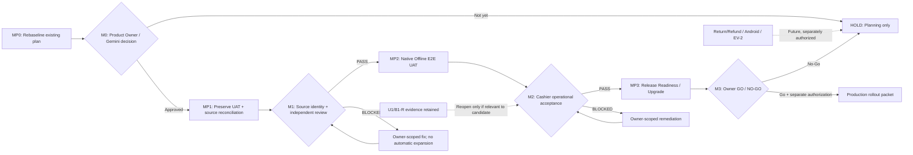
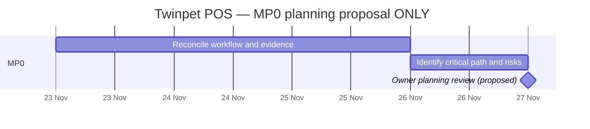

# Twinpet POS — Master Plan Dependencies (MP0 DRAFT)

**Prepared / updated:** 2026-11-21. MP0 and bounded Candidate N isolated implementation were Owner-authorized; Candidate N attempt has **STOPPED BLOCKED_DESIGN_CONFLICT** (no code/test), pending Owner floor-only policy. No new execution, Git merge or release authorized. Dates and dependencies do not create authority.

## MP0 tentative planning checkpoint (not deadline)

| Gate | Acceptance evidence | Current status |
|---|---|---|
| MP0/M0 | Approved Goal, phase, priorities, roles, lock list, authority reconciliation | SCOPED_READ_ONLY; FORMAL_PHASE_PENDING |
| MP1/M1 | UAT baseline and commit/build identity, reviewed integration delta | Candidate N `BLOCKED_DESIGN_CONFLICT` (no code/tests); Owner A/B/HOLD decision pending; Candidate I/MP1.3 LOCKED |
| MP2/M2 | Safe native offline E2E + cashier critical path on controlled build | LOCKED |
| MP3/M3 | Installer/upgrade proof and explicit Owner decision | LOCKED |

No MP1–MP3 delivery dates until formal successor phase decision. Candidate N execution stopped at design conflict; neither A nor B has been authorised. No auto-retry/test/merge. This does not close M1 or authorize other implementation phases. An approved evidence-only MP1.1/1.2 task does not authorize implementation. Todoist mirrors this proposal, not vice versa.
